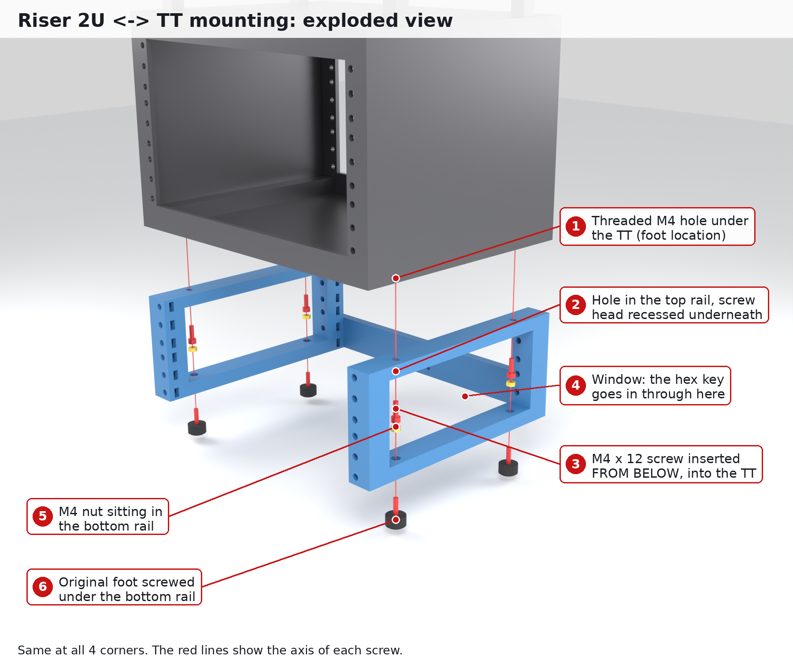
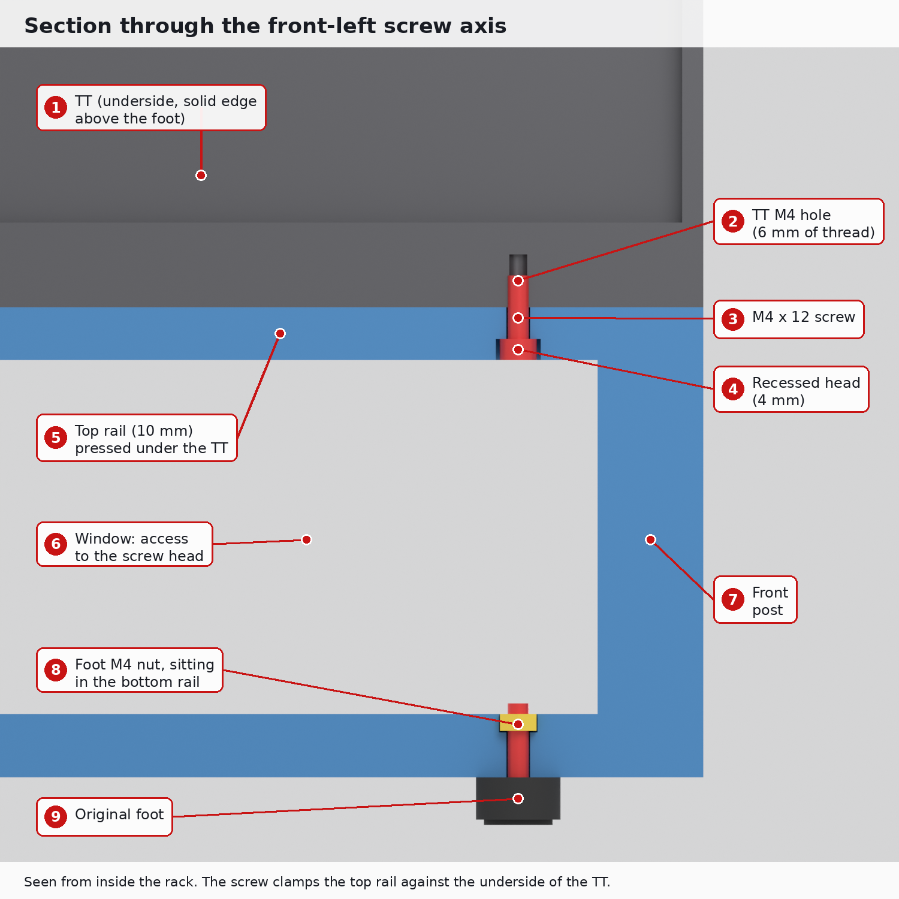
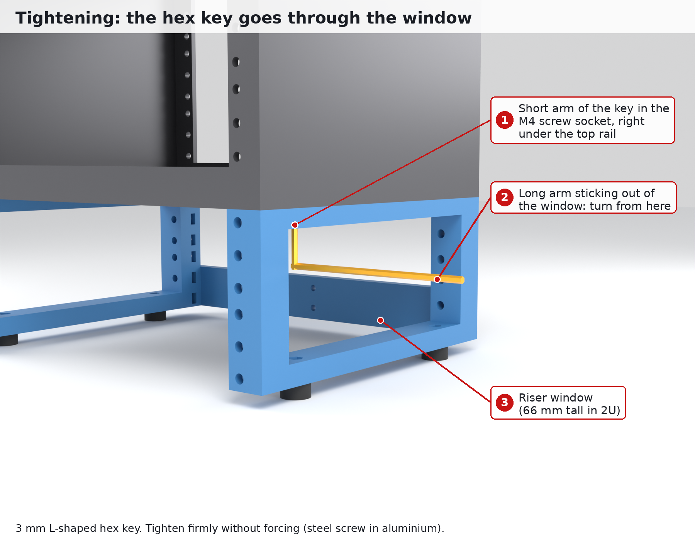

# Rehausse imprimée pour DeskPi RackMate TT couché : +1U, +2U ou +3U

Une rehausse qui se visse **sous** le RackMate TT posé à l'horizontale (mode 10", 3U), à la place des 4 pieds. Les pieds se remettent ensuite sous la rehausse. Avec +3U, le TT passe de 3U à **6U**.

Elle est dessinée à partir du plan officiel du TT (`reference/DP-0054_TT_aluminum_chassis.pdf`, dans le dépôt [DeskPi-Team/3DPrint-Models](https://github.com/DeskPi-Team/3DPrint-Models/tree/main/DeskPi_Official_Mechanical_Drawings)). English version: [README.md](README.md).

**Pour imprimer** : `stl/print-sets/centauri-carbon-2/<1U|2U|3U>/`. Les fichiers sont numérotés dans l'ordre, et [`docs/print-order.fr.md`](docs/print-order.fr.md) donne la répartition par plateau et les vérifications à faire avant.

## Le TT à l'horizontale (plan DP-0054)

Le plan dessine le TT **debout** (171 × 266 × 200). Couché, on le tourne de 90° :

| Quoi | Cote |
|---|---|
| hors-tout couché (L × H × P) | 266 × 171 × 200 mm, sans poignées ni pieds |
| rails 10" | 2 rangées de 9 trous #10-32 UNF = **3U**, entraxe **236,53**, pas EIA 15,88 / 15,88 / 12,70 |
| cadre avant et arrière | aluminium de 4 mm, bord de 20 mm, ouverture de 226 × 131 |
| 1er U du TT | commence 18,75 mm au-dessus du dessous (1er trou à 25,1 mm) |
| trous M4 du dessous (pieds) | **248,5 × 130** : à 8,45 et 9,05 mm des bords gauche et droit, à 35 et 165 mm de la face avant |

Mesuré directement sur le PDF, qui est à l'échelle 1:1 : 200 mm sur le plan donnent bien 200 mm. **À confirmer à la règle sur ton TT avant d'imprimer** (voir `docs/print-order.fr.md`).

## Ce qui change par rapport à la version T0

- largeur 266 au lieu de 282,25 : les côtés font **21,9 mm** de large au lieu de 30 ;
- entraxe des pieds 248,5 au lieu de 256,25 ;
- même entraxe de rails 236,53, même profondeur 200, même entraxe des pieds en profondeur 130 : le principe reste le même ;
- le passage libre entre les montants reste 222,25 (10" standard). Le TT a 226 d'ouverture, mais avec 226 il ne resterait que 2 mm de plastique autour des inserts. Les montants de la rehausse débordent donc de 1,9 mm vers l'intérieur de chaque côté, sans gêner un équipement 10".

Tous les contrôles du script passent : 3,9 mm de paroi entre l'insert et la face intérieure, 9,9 mm entre l'écrou M5 et la face extérieure, 5,5 et 7,9 mm autour du trou M4, et la fenêtre 1U laisse passer une vis M4 × 12.

## Principe

Chaque côté (gauche et droit) est un cadre vu de profil :

- **un montant avant et un montant arrière**, percés au pas EIA à l'entraxe 10" (236,53) ;
- **une lisse haute**, vissée en M4 dans les trous des pieds du TT. Le trou est oblong de ±1 mm en largeur ;
- **une lisse basse**, qui reçoit les pieds d'origine (écrou M4 posé dessus, accessible par la fenêtre).

Une **traverse arrière**, imprimée 2 fois, relie les montants arrière en bas. Elle empêche la rehausse de se déformer en parallélogramme quand on pousse sur le côté.

## Fichiers

- `stl/print-sets/centauri-carbon-2/<n>U/` : **ce qu'il faut imprimer**, version écrous M5, numéroté 1 à 5
- `stl/sides/` : tous les côtés (1U, 2U, 3U × `inserts` / `nuts` × `left` / `right`), d'une seule pièce, 200 mm de long
- `stl/test_fit.stl` (pièce de test), `stl/rear_brace_x2.stl` (traverse arrière, ×2)
- `docs/images/<n>U/` : les rendus (TT sur la rehausse, vue arrière, façade, plateau de la nuit)
- `docs/images/mounting/` : les rendus explicatifs de la fixation (en anglais)
- `reference/` : le plan officiel du TT (licence MIT, DeskPi Team)
- `cad/` : les scripts ; `build/` : fichiers intermédiaires (non versionnés)

## Visserie (rehausse complète, version écrous)

| Où | Quoi | Qté |
|---|---|---|
| Rehausse → TT (lisses hautes) | vis M4 × 12, tête CHC ou bombée de Ø8 maximum | 4 |
| Pieds d'origine → lisses basses | écrou M4, ou la vis d'origine du pied | 4 |
| Traverse → montants arrière | vis M5 × 16 + écrou M5 | 4 |
| Traverse, au milieu | vis M4 × 12 + écrou M4 | 2 + 2 |
| Équipements | écrou M5 + vis M5 × 16 | 3 par U et par montant utilisé |

La vis M4 × 12 du haut dépasse de **6 mm** dans le TT. Dévisse un pied pour voir la profondeur du trou : s'il fait moins de 6 mm, prends des M4 × 10.

Pourquoi M5 et pas #10-32 ? Les rails du TT sont taraudés en #10-32 UNF, une visserie difficile à trouver en France. Une vis M5 passe dans les trous de 5,5 mm des façades et étagères DeskPi. Les vis d'origine du TT ne vont donc pas dans la rehausse.

## Empiler plusieurs rehausses

La lisse basse a ses trous M4 au même entraxe que les pieds du TT (248,5 × 130), avec un logement d'écrou. Le haut d'une 2e rehausse se visse donc dessous comme sous le TT. Chaque rehausse fait exactement n × 44,45 mm, donc le pas des rails continue d'une rehausse à l'autre.

- Au raccord, prends des **M4 × 20**.
- Aligne les rails avec une vis M5 avant de serrer.
- Jusqu'à environ +6U au total, ça devrait tenir (non testé).

## Comment ça se fixe au TT (exemple en 2U)



Il n'y a **aucune pièce spéciale** sur le TT : on utilise ses 4 trous M4 taraudés, ceux où sont vissés les pieds.

1. On dévisse les 4 pieds du TT. Ses trous M4 restent libres dessous.
2. La rehausse se pose dessous : le haut de chaque côté, la **lisse haute**, vient plaquer contre le dessous du TT. Les trous de la lisse tombent pile sous ceux des pieds.
3. Une **vis M4 × 12** passe **par en dessous** dans la lisse haute et se visse dans le trou du pied du TT. Sa tête reste noyée dans un lamage de 4 mm, sous la lisse.
4. Pour atteindre cette tête, on passe la **clé Allen coudée de 3 mm** par la **fenêtre** du côté, l'ouverture rectangulaire entre la lisse haute et la lisse basse.
5. Les pieds d'origine se revissent sous la lisse basse, dans un écrou M4 logé dans la lisse.





Le plus simple est de **retourner le TT** (rack vide) sur une serviette : on pose les côtés dessus, on met les 4 vis, puis on remet le tout à l'endroit.

Rendus refaits par `make images`. Guide détaillé en anglais : [docs/mounting.md](docs/mounting.md).

## Montage

1. Glisser les écrous M5 dans les trous de rail dont tu as besoin.
2. Retourner le TT et dévisser les 4 pieds.
3. Poser les 2 côtés, montants alignés sur la face avant. Visser les 4 M4 × 12 par les fenêtres avec une clé Allen coudée.
4. Visser la traverse sur les 2 premiers trous des montants arrière, puis les 2 M4 au milieu.
5. Remettre les 4 pieds sous les lisses basses, puis remettre le TT à l'endroit et vérifier que rien ne bouge.

## À vérifier sur le vrai TT

- [ ] entraxe des pieds 248,5 × 130 (à la règle, **avant d'imprimer**)
- [ ] les pieds sont bien dans le panneau du dessous du TT couché
- [ ] profondeur du trou M4 du pied (≥ 6 mm, sinon M4 × 10)
- [ ] la pièce de test n°1 présentée sous le TT

## Régénérer

```sh
python -m venv .venv && .venv/bin/pip install -r requirements.txt
make stl       # vérifications + tous les STL (cad/riser.py)
make images    # aperçus + rendus Blender + étiquettes
```

Toutes les cotes du TT sont en tête de `cad/riser.py` (`RACK_W`, `FOOT_PITCH_X`…).

## Sources

- [Plans officiels DeskPi (DP-0054 TT)](https://github.com/DeskPi-Team/3DPrint-Models/tree/main/DeskPi_Official_Mechanical_Drawings)
- [DeskPi RackMate TT (page produit)](https://deskpi.com/products/pre-sale-deskpi-rackmate-tt-rackmount-mini-server-cabinet-for-network-servers-audio-and-video-equipment)
- [The Pi Hut – RackMate TT](https://thepihut.com/products/deskpi-rackmate-tt-7-10-0-5-1u-micro-server-rack)
![[DP-0054 TT Aluminum chassis.pdf]]