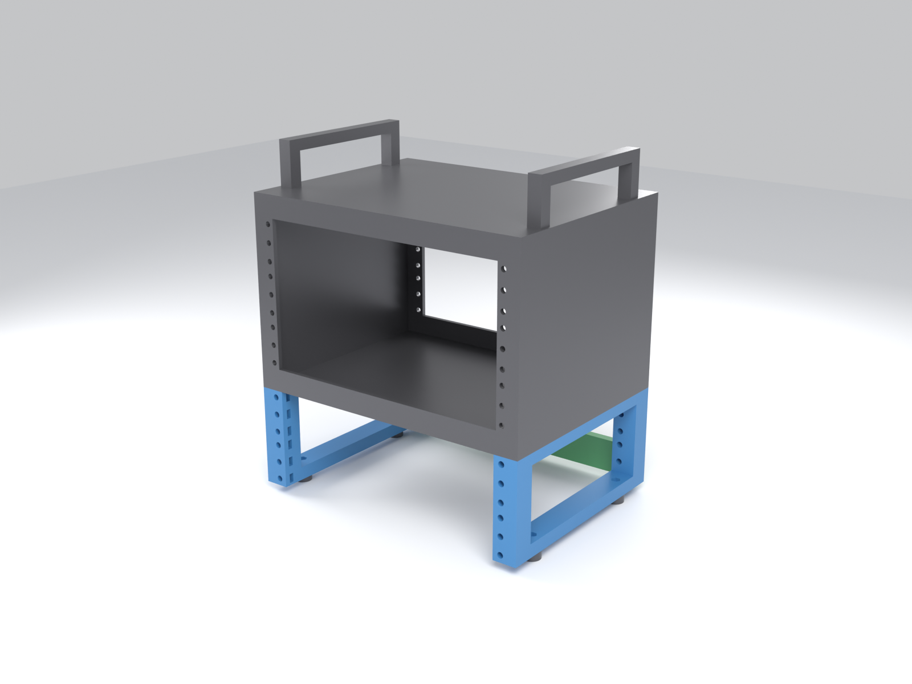

# DeskPi RackMate TT riser (+1U / +2U / +3U)

A 3D-printed riser that bolts **under** a [DeskPi RackMate TT](https://deskpi.com/products/pre-sale-deskpi-rackmate-tt-rackmount-mini-server-cabinet-for-network-servers-audio-and-video-equipment) lying **horizontally** (10" 3U mode) and adds 1, 2 or 3 extra rack units of 10" rails below it. It screws into the TT's own foot holes, and the original feet go back under the riser. No drilling, no modification to the TT.



> [!warning] Status: designed, not yet tested on a real TT
> All dimensions come from DeskPi's official drawing DP-0054 (see `reference/`). Before printing the sides, measure your TT's foot holes and print the test piece (see [Before you print](#before-you-print)).

| Riser | TT total | Filament (PETG, 4 walls, 30 %) | Plates on a 256 mm bed |
|---|---|---|---|
| 1U | 4U | ~185 g | 1 |
| 2U | 5U | ~225 g | 1 |
| 3U | 6U | ~270 g | 2 |

## How it works

Each side (left and right) is a rectangular frame seen from the side:

- a **front post** and a **rear post**, drilled on the EIA pitch at the 10" rail spacing (236.53 mm), so 10" shelves and panels mount like in the TT;
- a **top rail**, screwed with M4 × 12 screws into the TT's 4 M4 foot holes;
- a **bottom rail**, which takes the TT's original feet.

A **rear brace**, printed twice, ties the two rear posts together so the riser can't rack sideways.

**→ Mounting details with pictures: [docs/mounting.md](docs/mounting.md)**

## Before you print

1. **Measure the TT foot holes** with a ruler, centre to centre. You should get **248.5 mm** left to right (±1 mm tolerated) and **130 mm** front to back (no tolerance). If not, change `FOOT_PITCH_X` / `FOOT_PITCH_Y` in `cad/riser.py` and regenerate.
2. **Print `stl/test_fit.stl`** (~30 min). Check that an M5 nut slides into its slot, that an M4 nut fits the foot pocket, and that the M4 screw lines up with a TT foot hole.

## What to print

Ready-made sets, numbered in print order, are in `stl/print-sets/centauri-carbon-2/<1U|2U|3U>/`. They were laid out for a 256 × 256 mm bed (Elegoo Centauri Carbon 2) and use the M5-nut version:

| # | File | Qty |
|---|---|---|
| 1 | `1_test_fit.stl` | 1, print alone first |
| 2 | `2_<n>U_nuts_left.stl` | 1 |
| 3 | `3_<n>U_nuts_right.stl` | 1 |
| 4 | `4_rear_brace_A.stl` | 1 |
| 5 | `5_rear_brace_B.stl` | 1 (same part as #4) |

Plate layout and checklist: [docs/print-order.md](docs/print-order.md).

All parts: `stl/sides/` (1U, 2U and 3U × `inserts` / `nuts` × `left` / `right`, each side in one piece, 200 mm long, so a bed of at least 210 mm is needed), `stl/rear_brace_x2.stl`, `stl/test_fit.stl`.

**Settings:** PETG or ASA (PLA may creep under load), 4 walls, 30 % gyroid, 0.2 mm layers, **no supports**. The parts are already oriented.

### `nuts` or `inserts`?

| | `nuts` | `inserts` |
|---|---|---|
| How | M5 nut slid into a slot from inside the post | M5 heat-set brass insert (Ø6.4 × 5.8, e.g. Ruthex RX-M5x5.8) |
| Tool | none | soldering iron |
| Equipment screws | M5 × 16 | M5 × 10-12 |

The TT rails are tapped **#10-32 UNF**, which is hard to find in Europe. The riser uses **M5**, which fits the 5.5 mm holes of DeskPi shelves and panels. TT screws do not fit the riser.

## Hardware (2U, `nuts` version)

| Where | What | Qty |
|---|---|---|
| Riser → TT (top rails) | M4 × 12 socket head screw, head Ø ≤ 8 mm | 4 |
| Original feet → bottom rails | M4 nut (or the foot's own screw) | 4 |
| Rear brace → rear posts | M5 × 16 + M5 nut | 4 |
| Rear brace, middle joint | M4 × 12 + M4 nut | 2 + 2 |
| Equipment | M5 × 16 + M5 nut | 3 per U per post used |

The M4 × 12 goes **6 mm** into the TT. Unscrew a foot first: if the hole is shallower than that, use M4 × 10.

## Stacking

The bottom rail has its M4 holes at the same spacing as the TT feet (248.5 × 130), with nut pockets, and each riser is exactly n × 44.45 mm tall. So a second riser bolts under the first one exactly like the first one bolts under the TT, and the rail pitch stays continuous. Use **M4 × 20** at the joint and line up the rails with an M5 screw before tightening. Up to about +6U in total should be fine (not tested).

## TT dimensions used (lying horizontally)

DP-0054 shows the TT **standing** (171 × 266 × 200 mm). Rotated 90°:

| | Value |
|---|---|
| Outside (W × H × D) | 266 × 171 × 200 mm, without handles and feet |
| 10" rails | 2 × 9 holes #10-32 UNF = 3U, spacing 236.53, EIA pitch 15.88 / 15.88 / 12.70 |
| Front / rear frames | 4 mm aluminium, 20 mm border, 226 × 131 opening |
| Foot holes (bottom) | M4, **248.5 × 130** (8.45 / 9.05 mm from the ends, 35 and 165 mm from the front) |

The riser keeps a standard 222.25 mm clear width between posts (the TT has 226). Narrower would leave less than 3 mm of plastic around the inserts.

## Repository layout

```
cad/          Python sources (manifold3d) and Blender render scripts
  riser.py              parameters, checks, all STLs and print sets
  previews.py           assembled models + bed layouts for the renders
  render_previews.py    Blender: docs/images/<n>U/
  mounting_models.py    models for the mounting explanation
  render_mounting.py    Blender: raw mounting views
  annotate_mounting.py  Pillow: labels -> docs/images/mounting/
stl/          generated, ready to print
docs/         mounting guide, print order, images
reference/    official DeskPi TT drawing (MIT, DeskPi Team)
build/        intermediate files (not versioned)
```

## Regenerating

```sh
python -m venv .venv && .venv/bin/pip install -r requirements.txt
make stl        # checks + all STLs (cad/riser.py)
make images     # previews + Blender renders + labels (needs blender in PATH, ~10 min on CPU)
```

All TT dimensions are at the top of `cad/riser.py`. Code comments are in French.

## Credits and license

- TT dimensions: [DeskPi official mechanical drawings](https://github.com/DeskPi-Team/3DPrint-Models/tree/main/DeskPi_Official_Mechanical_Drawings), MIT License, © DeskPi Team. A copy of the DP-0054 drawing and its license is in `reference/`.
- License for this project: not chosen yet.

A French version of this README is in [README.fr.md](README.fr.md).
