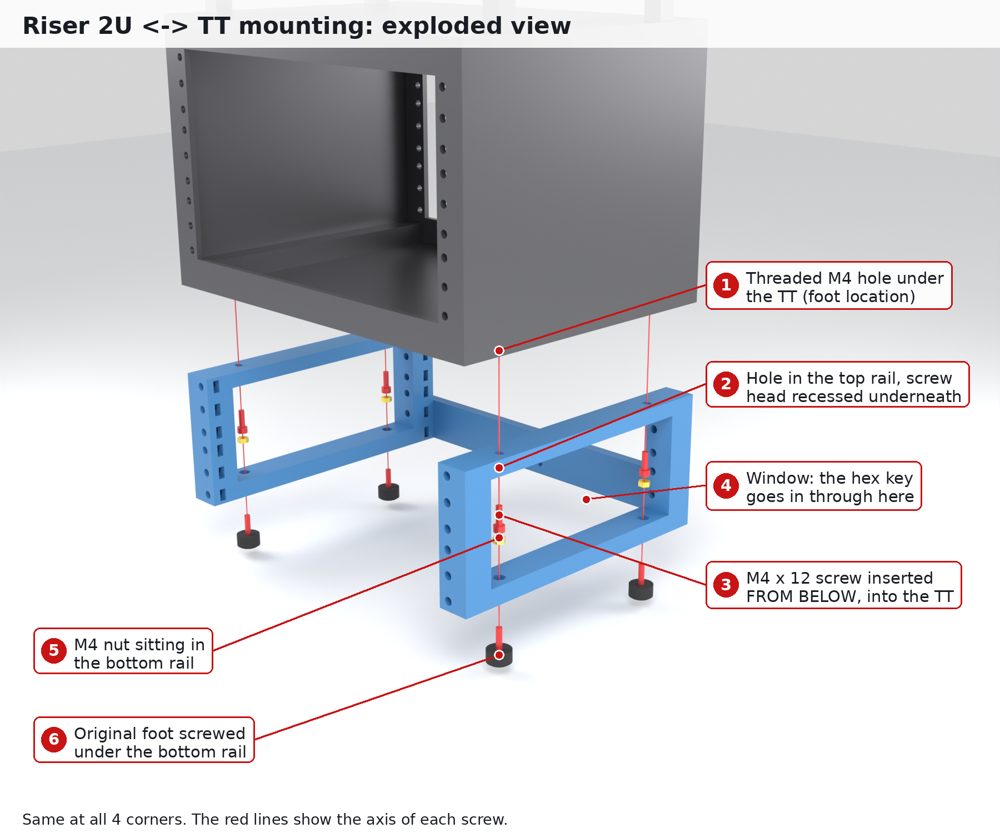
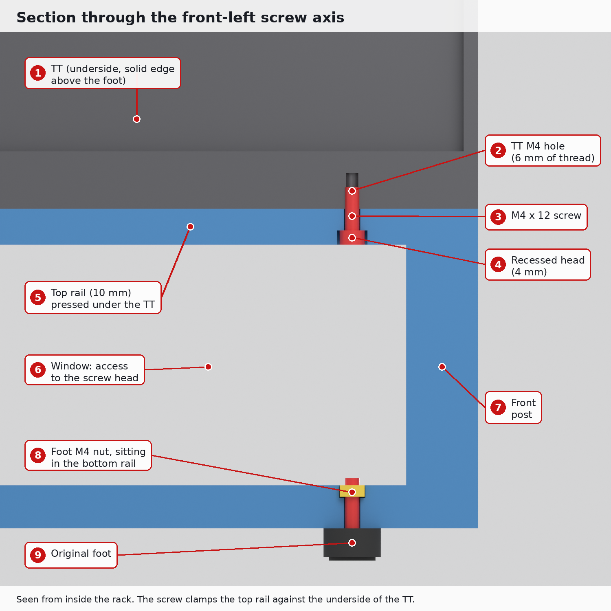
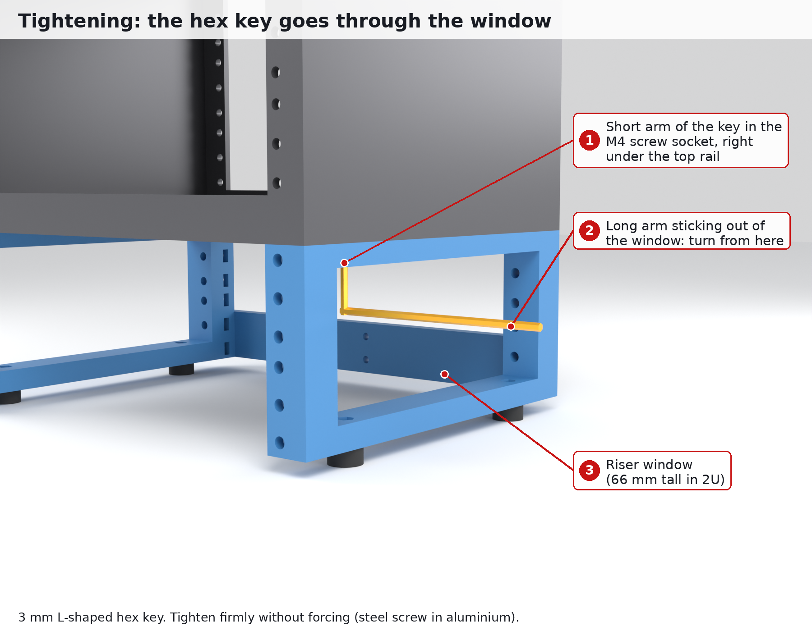

# Mounting the riser under the TT

The riser needs **no special part on the TT**: it uses the TT's 4 threaded M4 holes, the ones the feet are screwed into. The pictures show the 2U riser. 1U and 3U work the same way, only the window height changes.

## The joint, step by step

1. **Remove the 4 feet** from the TT. This leaves 4 threaded M4 holes on its underside, at 248.5 × 130 mm.
2. **Put the riser underneath.** The top of each side, the **top rail**, sits flat against the TT's underside, and its holes line up with the foot holes. The holes are slotted ±1 mm left to right to absorb small differences.
3. **Screw in from below.** An **M4 × 12 socket head screw** goes up through the top rail into the TT's foot hole. Its head sits in a 4 mm counterbore under the rail, so it doesn't touch anything.
4. **Reach the screw through the window.** Each side is a frame. The rectangular opening between the top and bottom rails, the **window**, lets an **L-shaped 3 mm hex key** reach the screw head.
5. **Put the feet back** under the bottom rail. They screw into an M4 nut sitting in a pocket on top of the bottom rail, which you can also reach through the window.

The section above cuts through the front-left screw:
- the screw clamps the 10 mm top rail against the TT;
- 6 mm of thread goes into the TT;
- the foot's screw goes through the bottom rail into its nut.

## Easiest way to do it

1. Empty the TT and lay it **upside down** on a towel.
2. Unscrew the 4 feet.
3. Put the two sides on it, with the posts flush with the front face. The front is the face with the rail holes.
4. Start the 4 M4 × 12 screws by hand, then tighten them through the windows. Tighten firmly but don't force: they are steel screws in aluminium.
5. Screw the rear brace onto the first 2 holes of the rear posts (M5), then the 2 M4 screws in the middle.
6. Put the feet back under the bottom rails and turn the whole thing upright. Press on the top and rock it gently: nothing should move.

## Check on your TT before buying screws

| Check | If different |
|---|---|
| Foot hole spacing: 248.5 mm (left-right) × 130 mm (front-back) | change `FOOT_PITCH_X` / `FOOT_PITCH_Y` in `cad/riser.py` |
| Foot hole depth ≥ 6 mm | use M4 × 10 instead of M4 × 12 |
| Foot type: screw through the foot | it goes into the M4 nut in the bottom rail |
| Foot type: threaded foot (acts as a nut) | use an M4 × 16 down through the bottom rail into the foot, and leave out the nut |

## Stacking two risers

The bottom rail has the same hole pattern as the TT's underside. A second riser therefore bolts under the first one in exactly the same way. Use **M4 × 20** at that joint, because the screw has to go through the 12 mm bottom rail of the upper riser to reach its nut.

---

Pictures are generated by `cad/mounting_models.py`, then `blender -b -P cad/render_mounting.py`, then `python cad/annotate_mounting.py` (or `make images`).
